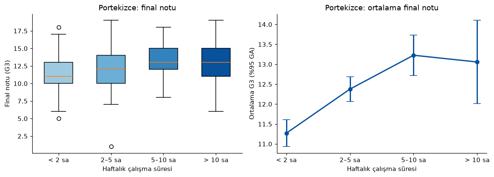
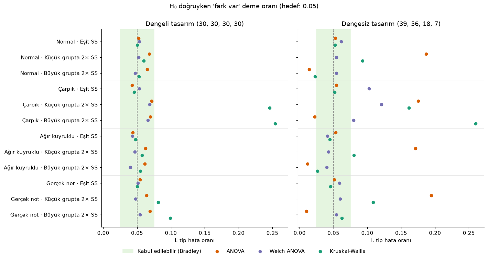

# Grup Karşılaştırmalarında Test Seçimi: Sentetik Veri, Gerçek Veri ve Simülasyon

Üç veya daha fazla grubu karşılaştırırken hangi testi kullanmalıyız? Bu proje soruyu üç adımda ele alıyor:

1. **Sentetik veri:** Ders kitabı akışı (varsayım kontrolü → ANOVA / Kruskal-Wallis → post-hoc → bağımlı test), etkisi bilinen veriyle.
2. **Gerçek veri:** Aynı akış, öğrencilerin haftalık çalışma süresi ile final notları arasındaki ilişkiye uygulanıyor.
3. **Simülasyon:** Gerçek veride yapılan test seçiminin doğru olup olmadığı Monte Carlo yöntemiyle sınanıyor.

## Öne çıkan bulgular

**Gerçek veri (UCI Student Performance, Portekizce dersi, n = 634)**

- Haftalık çalışma süresi ile final notu arasında anlamlı ama **küçük** bir ilişki var (Kruskal-Wallis H(3) = 45.58, p < .001, ε² = 0.07).
- Bu fark **1. dönemde zaten mevcut**. Dönem içi gelişim (G3 − G1) gruplar arasında farklı değil (p = .132). Daha çok çalışan öğrenciler dönem boyunca daha fazla ilerlemiyor; baştan beri daha başarılılar.
- Haftada 5 saatin üzerinde çalışmanın ek bir getirisi görülmüyor (5–10 sa ile > 10 sa arasındaki fark: p = .51).
- Matematik dersinde sonuç **zayıf ve kırılgan**: Final sınavına girmeyen öğrenciler (G3 = 0) analize katılınca p değeri .011'den .056'ya çıkıyor.



**Simülasyon (24 koşul × 5000 tekrar)**

- Gruplar dengesizse ve küçük grubun varyansı büyükse, klasik ANOVA'nın I. tip hata oranı %5 yerine **%17–20** oluyor.
- **Welch ANOVA** 24 koşulun 21'inde hata oranını kabul edilebilir aralıkta tutuyor.
- Kruskal-Wallis çarpık dağılımlarda en güçlü test. Ancak varyanslar farklıysa "ortalamalar eşit" hipotezi için hata oranı **%25'e** kadar çıkıyor, çünkü bu test ortalamaları değil dağılımları karşılaştırıyor.
- Gerçek verinin koşullarında I. tip hata oranları: Welch 0.050, ANOVA 0.067, Kruskal-Wallis 0.102.

**Sonuç:** "Shapiro-Wilk anlamlıysa Kruskal-Wallis kullan" kuralı büyük örneklemde yanıltıcı olabilir. Ortalamalar karşılaştırılıyorsa varsayılan seçim Welch ANOVA olmalı.



## Proje yapısı

```
├── notebooks/
│   ├── 01_sentetik_veri.ipynb     # Ders akışı: ön test denkliği, ANOVA, Tukey, bağımlı t-testi
│   ├── 02_gercek_veri.ipynb       # Çalışma süresi ve final notu, replikasyon, duyarlılık analizi
│   └── 03_guc_simulasyonu.ipynb   # I. tip hata ve güç simülasyonu
├── src/
│   └── istatistik.py              # Test seçimi, etki büyüklükleri, Tukey / Games-Howell / Dunn
├── data/                          # UCI Student Performance (student-mat.csv, student-por.csv)
├── figures/                       # Notebook'ların ürettiği grafikler
└── requirements.txt
```

`src/istatistik.py` modülü, varsayım sonuçlarına göre testi otomatik seçer:

| Normallik | Varyans homojenliği | Test | Post-hoc | Etki büyüklüğü |
|---|---|---|---|---|
| Sağlanıyor | Sağlanıyor | Tek yönlü ANOVA | Tukey HSD | η² |
| Sağlanıyor | Sağlanmıyor | Welch ANOVA | Games-Howell | ω² |
| Sağlanmıyor | – | Kruskal-Wallis | Dunn + Holm | ε² |

Bağımlı iki ölçüm için farkların normalliğine göre bağımlı t-testi (d_z) ya da Wilcoxon işaretli sıralar testi (sıra-çift serisel r, bootstrap GA) kullanılır.

## Çalıştırma

```bash
pip install -r requirements.txt
jupyter lab notebooks/
```

Notebook'lar `notebooks/` klasöründen çalıştırılmalıdır. Tüm rastgele süreçlerde seed sabittir; sonuçlar tekrarlanabilir. Simülasyon notebook'u normal bir bilgisayarda birkaç dakikada tamamlanır.

## Sınırlılıklar

- Gerçek veri **gözlemsel**: Öğrenciler gruplara rastgele atanmamış ve çalışma süresi öğrenci beyanına dayanıyor. Bulgular ilişki gösteriyor, neden-sonuç göstermiyor.
- Veri Portekiz'deki iki okuldan geliyor; genellenebilirliği sınırlı.
- G3 = 0 değerlerinin "sınava girmeme" olarak yorumlanması bir varsayım. Bu yüzden iki seçenek de duyarlılık analizinde raporlanıyor.
- Simülasyon dört dağılım, iki tasarım ve üç varyans örüntüsüyle sınırlı.

## Veri kaynağı

Cortez, P., & Silva, A. (2008). *Using data mining to predict secondary school student performance.* Proceedings of 5th FUture BUsiness TEChnology Conference, 5–12.
Veri: [UCI Machine Learning Repository – Student Performance](https://archive.ics.uci.edu/dataset/320/student+performance), lisans CC BY 4.0.
